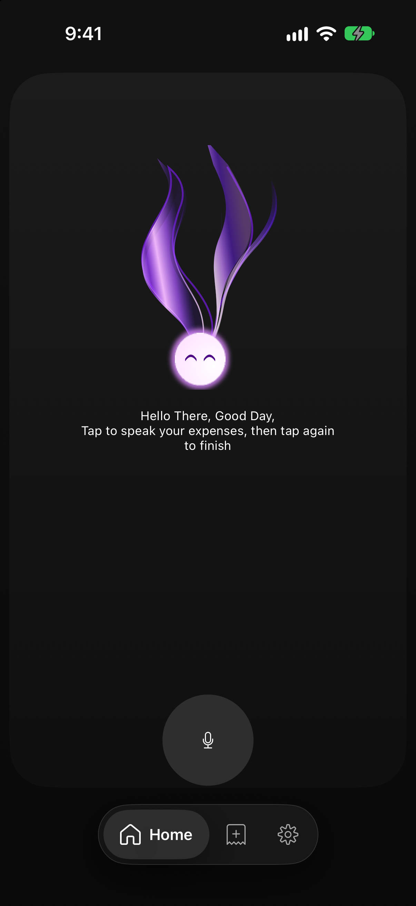
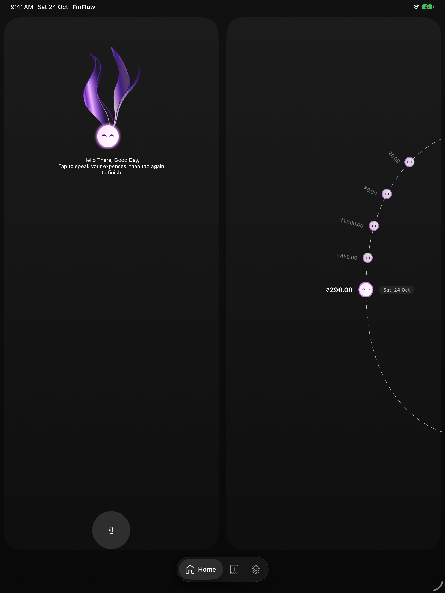
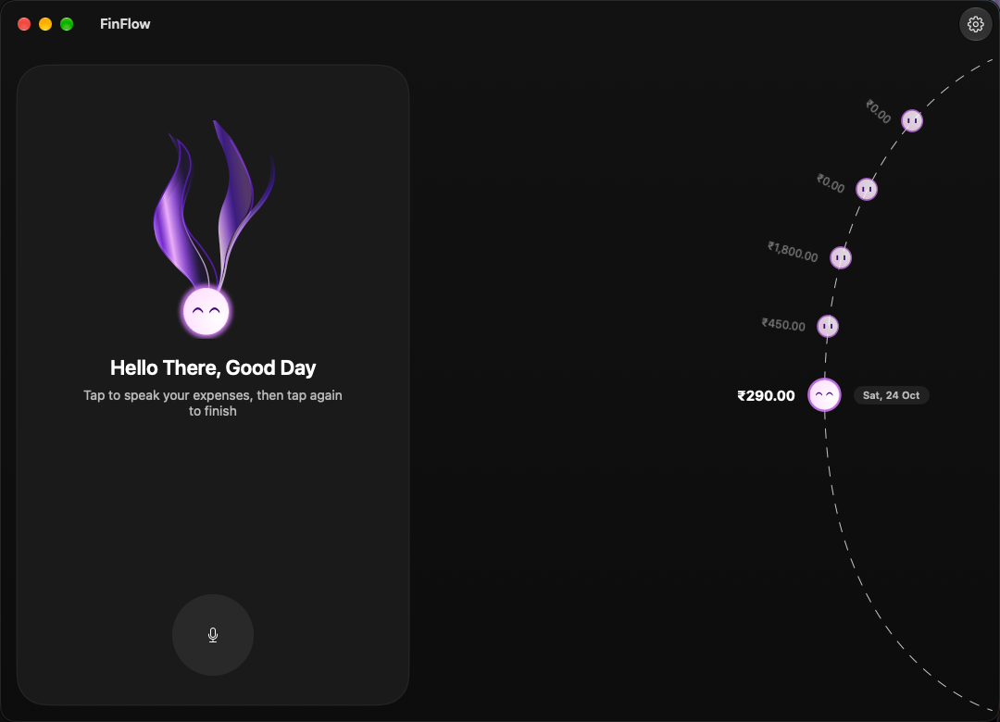

# FinFlow

FinFlow is an on-device voice expense tracker for Indian rupees. You tap the microphone, say what you spent, and the expense is saved on that device. There is no account and no cloud sync. The iPhone, iPad, Mac, and Android copies each keep their own notes.

The spoken amount is parsed on the device, including lakh and crore. Filler words are dropped, and spoken numbers are stored as digits.

<p align="center">
  
  
</p>

<p align="center">
  
</p>

## Downloads

Installable builds are attached to [GitHub Releases](https://github.com/k-aksha/finflow/releases):

- **FinFlow-macOS.dmg** for Mac
- **FinFlow-iOS.ipa** for iPhone and iPad
- **FinFlow-android.apk** for Android

On a Mac, open the downloaded app with a right-click and choose Open the first time. The iOS package installs on devices included in the Apple development signing for this project. The Android package is a sideload build: allow install from this source, then open the APK.

## Build it yourself

Apple builds need Xcode 27. Open `finflow.xcodeproj`, choose the finflow scheme, and run it on iPhone, iPad, or My Mac. The Mac destination is My Mac, not My Mac (Designed for iPad).

Android builds need JDK 21 and Android SDK 35. From `android/`:

```bash
export JAVA_HOME="$(/usr/libexec/java_home -v 21)"
./gradlew :app:assembleDebug
```

The installable APK is `android/app/build/outputs/apk/debug/app-debug.apk`.

## License

Personal use is allowed. Commercial use is not, and you may not sell FinFlow or charge anyone for a copy. See [LICENSE](LICENSE).
